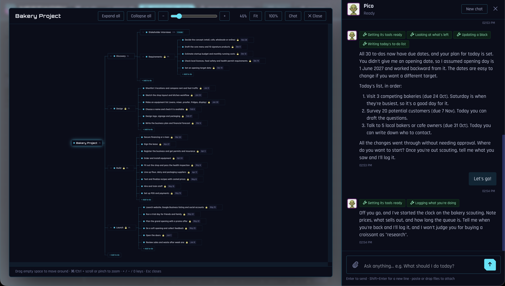

# Nestwork


Nestwork is a project planner that runs on your Mac. Every project is a set of blocks nested inside blocks, and rules decide what has to finish before something else can start. An AI agent built on Claude Code works with you in a chat: it reads your projects, plans your day, logs what you did and runs tasks for you on a schedule.



A bakery launch might nest Discovery, Design, Build and Launch, each with its own board, and progress rolls up to the top.

## Table of contents

- [Features](#features)
- [Requirements](#requirements)
- [Installation](#installation)
- [Usage](#usage)
- [Definitions](#definitions)
- [License](#license)

## Features

### AI help with planning

The agent sees the same projects you do through Nestwork's MCP server. Ask it "what should I do today?" or "what's left for the game project?" and it looks the answer up in your projects. *Plan my day* has it read your overdue, due and ready to-dos (and your Google Calendar, if connected), propose times with breaks, and save the plan you agree on. It can also run your weekly review and add to-dos, notes and reminders.

You decide how much it may change: *Read only*, *Ask first* (the default, which holds each change for your approval) or *Full access*. Its changes follow the same rules as yours, and ⌘Z undoes them.

### A more personal agent

You give the agent a name, a personality and a tone during a short setup. A shared memory file keeps lasting facts about you across chats, and lines can expire on a date so old news drops out. Every new chat starts with the agent reading how your last conversations went, and before it asks what you did today it checks finished to-dos, focus sessions and notes. When you mention something you did that nothing recorded, it logs the activity itself.

### HUD

The first page is a heads-up display: the clock, today's tasks with one-click Done and Start, upcoming reminders, the week ahead, every project's progress, your Claude usage limits and the agent's last reply. The focus timer sits in the middle.

### Productivity tracker

The focus timer runs as a Pomodoro or a stopwatch and stays in sync across every open device. Each session can be tied to a to-do or project, and you rate how productive it felt when it ends. The Focus page shows time against your daily goal, a daily score, your streak, time per project and the hours you focus best. To-dos can carry estimates, and Nestwork forecasts a finish date from your recent pace.

### Scheduled tasks you can follow

Ask the agent to "brief me every morning at 7" and it creates a task with a cron schedule (or a single run). Each run is a fresh Claude session with the Nestwork tools, and its answer is saved and posted to the chat. The *Agent's Work* tab lists every task with its schedule, next run and run history, where you can run, pause, edit or delete it. If Nestwork was off when a run was due, that run is skipped and the agent tells you about it in your next chat.

## Requirements

- macOS or Linux with bash (the start script uses `lsof`)
- Python 3 (tested with 3.14)
- Internet access on the first start, to install packages
- [Claude Code](https://claude.com/claude-code), installed and signed in, for the agent. The planner, timer and HUD work without it.

Nestwork talks to Claude only by running the official `claude` command you installed, the same way you would in a terminal. It never touches Claude Code's sign-in (OAuth) tokens or calls Anthropic's servers itself, so all usage goes through your own login.

## Installation

```bash
git clone https://github.com/Jubel9/nestwork.git
cd nestwork
./run.sh start
```

The first start creates `.venv` and installs `requirements.txt` by itself.

To use the Nestwork tools in Claude Code outside the app, see Settings → Connect Claude.

## Usage

```bash
./run.sh
```

This opens a menu to start, stop or restart the server, change its port, open the app and read the log. Each also works directly, e.g. `./run.sh stop` or `./run.sh port 9000`.

Open http://localhost:8834 (the default port). The setup page walks you through creating your agent. After that, press **V** to switch between the HUD, Focus and your projects, **C** to open the chat and **⌘K** to search everything.

Your data stays on your machine in `data/` (the database, the agent's persona and backups), which git ignores. Run `./run.sh check` to lint and run every test.

## Definitions

| Term | Meaning |
| --- | --- |
| Block | Anything you track: a project, a group or a single task. Blocks hold other blocks. |
| Phase | A column a project moves through. The first means not started and the last means done. Each project has its own. |
| Rule | "Move X to phase A when Y reaches phase B." A block can't pass that phase until the rule is met, and it moves there by itself once it is. |
| Bubble | A block with to-dos inside. It sits in the phase of its slowest to-do and moves as they move. |
| Agent | Claude Code running headless with the Nestwork tools and your persona. |
| MCP | Model Context Protocol, the standard Claude uses to call Nestwork's tools. |
| Agent access | The setting that decides whether the agent's changes are refused, held for approval or applied. |
| Scheduled task | A prompt plus a cron schedule that the agent runs by itself. |
| Cron expression | Five fields, `minute hour day month weekday`, in local time. `0 7 * * *` means every day at 07:00. |
| Pomodoro | A focus session (25 minutes by default) followed by a break. |

## License

MIT, see [LICENSE](LICENSE). `tests/fixtures/c2pa_test_key.pk8` is a throwaway test key for the C2PA tests and has no real signing value.
